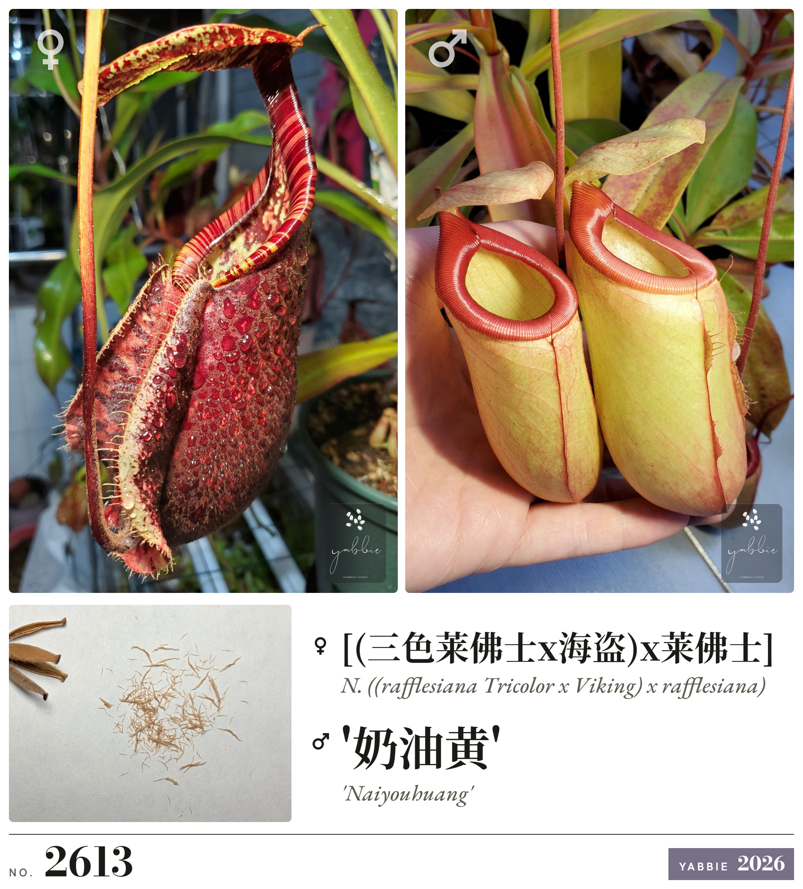
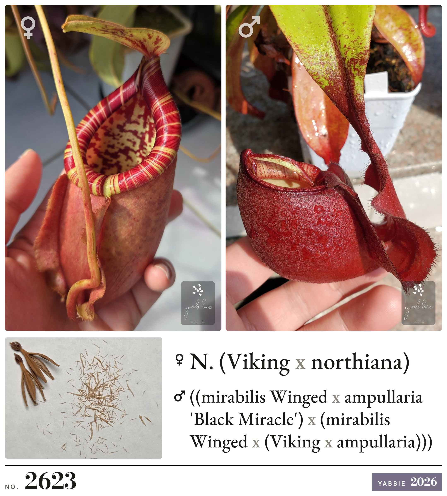
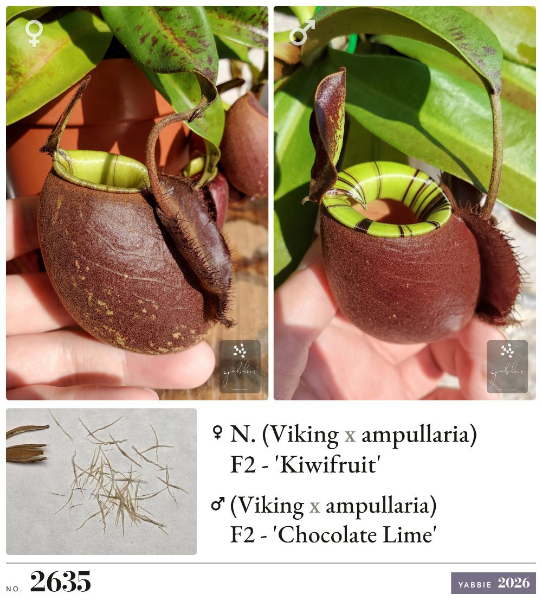

# 猪笼草亲本组图 · Nepenthes Parent Cards

把猪笼草杂交清单和母本、父本、种子三张照片，排成可以直接发布的"亲本组图"。在浏览器里就能用，无需安装或注册，照片不会上传。

**在线使用：<https://hybrid.yabbie.fun/>**

<p>
  
  
  
</p>

## 用途

出售或分享杂交猪笼草种子、幼苗时，通常每个杂交组合要配一张图：同时展示两个亲本和种子，并标注编号、中英文名和水印。手工逐张排版很费时间，本工具可以批量完成。

## 功能

- **批量导入清单**：每行写一个杂交组合，格式为 `中文名 [Tab] 英文名, 编号`（如 `YAB-X2615`），也可以只写中文名或只写英文名。名称按最外层的 `x` 自动拆成母本和父本。再次导入同一编号时只更新名称，已放好的照片和裁剪保留不变。
- **照片调整**：拖入照片，或点击添加。照片可以平移、缩放、旋转、水平翻转、锁定；锁定的照片在所有卡片中保持同一裁剪。在手机上，单指平移、双指缩放，种子图还能双指旋转。
- **版式**：比例可选 1:1、3:4 或自由比例（自由比例附 A/B/C 三套预设，可调亲本图比例和种子图尺寸）。卡片文字可选"中英"或"仅英文"。底栏布局、名称对齐、名称大小、年份颜色都可以调整。
- **水印**：母本照片标注种子提供者，父本照片标注花粉提供者。可选闲鱼、小红书、Facebook、Instagram 账号，也可以上传透明背景的 PNG 作为自定义水印。
- **导出**：单张或全部导出为 PNG / JPG，倍率可选 1×、2×、4×。
- **工程文件**：所有卡片、照片、裁剪和设置可以保存为一个 `.json` 文件，在其他设备或浏览器中打开后继续编辑。
- **界面语言**：中文 / English。
- **AI 代理接口**：页面提供 `window.nepCards` 对象，AI 代理可以通过浏览器自动化批量建卡、放入照片、导出，可供 AI 代理自学的操作指南见 [`llms.txt`](llms.txt)。

## 隐私与数据

- 所有处理都在浏览器中完成，没有服务器端，照片和卡片不会上传。
- 数据保存在当前浏览器的 localStorage 和 IndexedDB 中，不同浏览器、不同设备之间互不相通。换浏览器、换设备或清除网站数据之前，请先用"保存工程"导出。
- 页面运行时会请求以下第三方资源：
  - React（unpkg）
  - Google Fonts
  - html-to-image（jsDelivr，导出图片时使用）
  - GitHub API（页脚显示 Star 数，请求失败不影响使用）
- 不支持 HEIC 格式的照片，请先转成 JPG。

## 本地运行

页面启动时要读取自身的 HTML，所以必须通过 HTTP 打开。直接双击 `index.html`（`file://`）无法运行。

```bash
git clone https://github.com/yabbie/nepenthes-hybrid-cards.git
cd nepenthes-hybrid-cards
python -m http.server 8765
# 浏览器访问 http://127.0.0.1:8765/
```

## 项目结构

```
index.html   页面本体：模板、样式和逻辑
support.js   Claude Design 运行时，在浏览器中解析并渲染 index.html
llms.txt     给 AI 代理看的接口说明
assets/      展示图、平台标志与水印
```

本项目用 Claude Design 制作，没有构建步骤。`index.html` 是导出产物，可以直接修改。

## 反馈

问题和建议请提交 [Issue](https://github.com/yabbie/nepenthes-hybrid-cards/issues)。

## 许可

- 代码（`index.html`、`llms.txt`）以 [MIT 许可证](LICENSE) 发布。
- `support.js` 是 Claude Design 的运行时文件，不在本项目的授权范围内。
- `assets/` 中的植物照片和组图示例版权归作者所有，未经许可请勿用于其他用途。
- 闲鱼、小红书、Facebook、Instagram 的标志是各自所有者的商标，在本项目中仅用于水印标注。

---

## English

**Nepenthes Parent Cards** is a browser tool for Nepenthes breeders. You paste a list of crosses and add the mother, father and seed photos. The tool then lays out share-ready parent cards (PNG/JPG) with cross numbers, Chinese/English names and optional watermarks.

- **Live:** <https://hybrid.yabbie.fun/>
- **Privacy:** everything runs in the browser and photos are never uploaded. Data stays in the browser's localStorage/IndexedDB; use *Save project* to move it to another browser or device.
- **Layout:** card ratios 1:1, 3:4 or free. Card text can be English-only, and the interface is available in English.
- **AI agents:** the page can be driven through `window.nepCards`. [`llms.txt`](llms.txt) is a guide AI agents can read on their own to learn how to operate it.
- **Running locally:** serve the folder over HTTP (`python -m http.server`). Opening `index.html` via `file://` does not work.
- **License:** code is MIT. Photos are © the author. `support.js` is the Claude Design runtime and is not covered.
